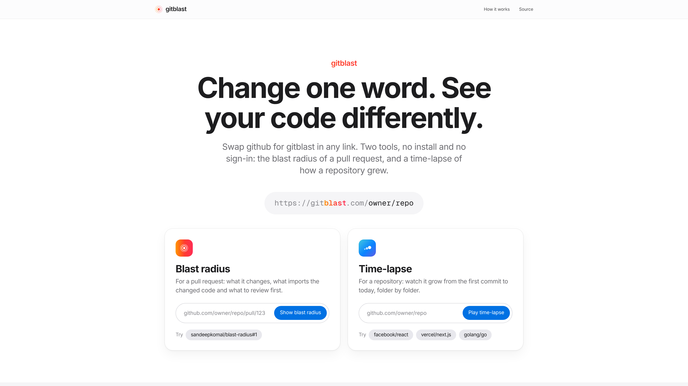
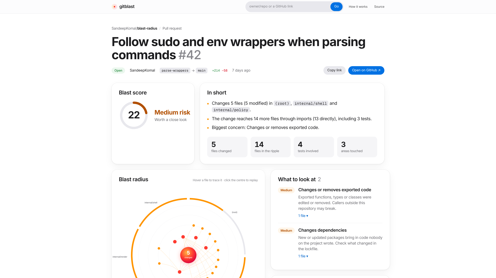
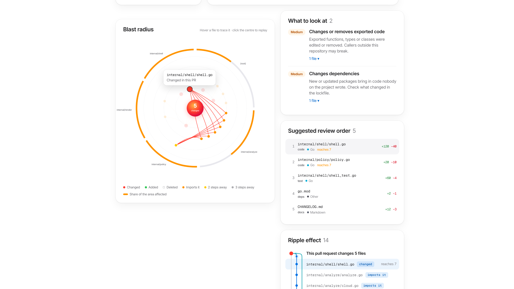
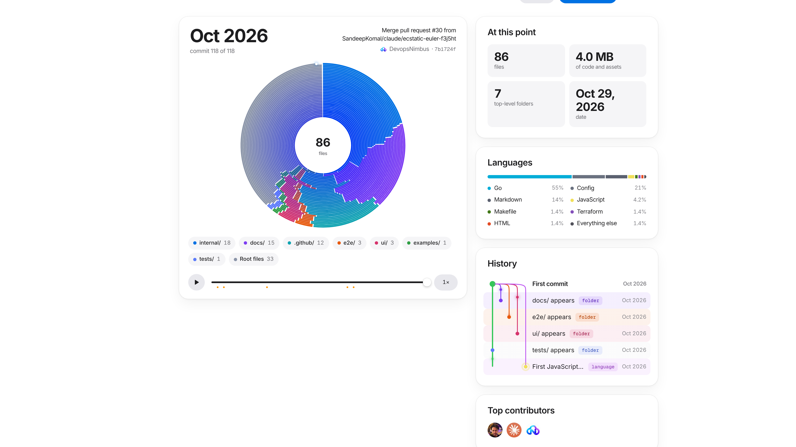
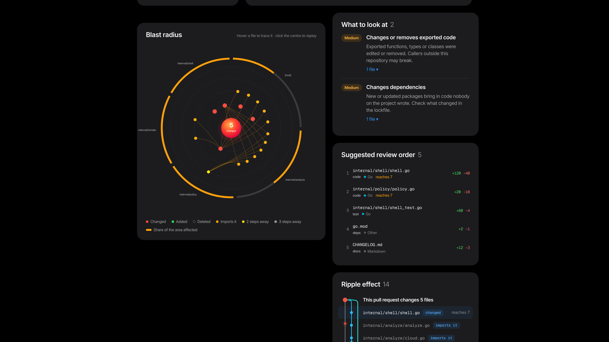

# gitblast

**Change one word in any GitHub link and see your code differently.**

```
https://github.com/owner/repo/pull/123   →   https://gitblast.com/owner/repo/pull/123
https://github.com/owner/repo            →   https://gitblast.com/owner/repo
```



gitblast has two tools, both free, open source and with no sign-in:

- **Blast radius**: for a pull request, what it changes, everything that imports the changed code, the tests that
  cover it, and what to review first.
- **Time-lapse**: for a repository, how it grew from its first commit to today, folder by folder.

> gitblast.com is not deployed yet. Until it is, [run it locally](#running-it-locally) and use
> `http://localhost:3000` in place of `https://gitblast.com` in the steps below.

## How to use it

There are three ways in. All of them work for both tools.

1. **Swap the domain.** On any GitHub repository or pull request page, change `github` to `gitblast` in the
   address bar and press Enter.
2. **Paste the whole link after the domain.** `gitblast.com/https://github.com/owner/repo/pull/123` works too,
   which is handy from a bookmarklet.
3. **Use a search box.** On the home page, paste a link into the tool you want:
   - **Blast radius** takes a pull request: a PR link, or `owner/repo#123`.
   - **Time-lapse** takes a repository: a repository link or `owner/repo`. Given a PR link, it opens that
     PR's repository.

   The search box at the top of every page takes either kind.

Only public repositories work. Large repositories can take up to a minute the first time, after which results
are cached.

## Blast radius

Open `/owner/repo/pull/123`.



The top of the report gives you:

- **A blast score** from 0 to 100, with a risk level.
- **A short summary** of what changes, how far it reaches and the biggest concern.
- **Four counts:** files changed, files in the ripple, tests involved and areas touched.

### The blast radar



The changed files sit on the inner ring around the core. Each ring further out is one more import away: files
that import the change directly, then two steps away, then three. The circle is split into slices by area
(`internal/shell`, `packages/ui`…), and the orange band around the edge shows how much of each area the change
reaches.

- **Hover a file** to trace its import path back to the change, or, for a changed file, out to everything it
  reaches.
- **Click a file** to open it on GitHub.
- **Hover an area's name or band** to highlight its slice and see how much of it is affected.
- **Click the core** to replay the shockwave.

### The rest of the report

- **What to look at:** deleted files that are still imported, security-sensitive code, database migrations,
  changed or removed exports, CI and dependency changes, missing tests, wide ripples and very large PRs.
- **Suggested review order:** foundations first, then the code built on them, then tests, config and docs.
- **Ripple effect:** a graph that branches from the pull request to each changed file and the files that import
  it. Hover a row to find that file on the radar.
- **Tests:** the tests the PR changes, and the existing tests that import the changed code, which you should run.
- **Areas:** how much of each part of the repository is changed or in the ripple.

## Time-lapse

Open `/owner/repo`.



The repository is drawn as **growth rings**, like a cut through a tree trunk. The first commit is at the centre
and today is on the outside. Each ring is split into one coloured arc per top-level folder, sized by that
folder's share of the files at that point.

- **Playback** starts on its own and sweeps each new ring in like a clock hand.
  - Use **Play/Pause** and the speed button (0.5× to 4×).
  - Drag the timeline to scrub. The orange dots under it mark milestones.
  - Keyboard: <kbd>Space</kbd> plays or pauses, and <kbd>←</kbd> <kbd>→</kbd> step one point in time.
- **Hover an arc** to follow that folder through every ring. The tooltip shows its files at that point, its
  share of the repository, its change since the previous point and its biggest sub-folders.
- **Click a ring** to jump to that point in time.
- **Folder chips** under the rings show live counts and growth. Hover one to highlight the folder, and click to
  pin it.
- **History** is a git-style graph of milestones: new folders branch off in their own colour, and the first
  appearance of each language is marked. While the time-lapse plays, a line fills down the graph, each moment
  lights up when it's reached, and signals keep flowing along the branches. Click a moment to jump there.

The side panels show the file count, size, folders and languages at the current point, and the top contributors.

## Dark mode

Everything follows your system's light or dark setting.



The pull request in these screenshots is an example built from this repository's real code. The time-lapse is
the real history of [SandeepKomal/blast-radius](https://github.com/SandeepKomal/blast-radius).

## How it works

There is no AI and no guessing. For a pull request, gitblast:

1. lists the changed files through the GitHub API;
2. streams the source tarball at the PR's head commit and reads imports from every source file in memory;
3. resolves imports to files for TypeScript/JavaScript (including `@/` aliases and monorepo workspaces), Python,
   Go (through `go.mod`), Rust, Java, Kotlin, Scala, Ruby, PHP, Dart, C and C++;
4. walks outwards from the changed files through everything that imports them, up to three steps.

The time-lapse samples up to 36 evenly spaced commits and reads the file tree at each one, so even repositories
with long histories need only a few dozen API calls.

Static import analysis can't see dynamic imports, reflection or code generation. The report says when a
repository was too large to read in full.

## Running it locally

Requires Node.js 20.9 or later.

```bash
git clone https://github.com/SandeepKomal/gitblast.git
cd gitblast
npm ci
cp .env.example .env.local   # optional: add a GITHUB_TOKEN
npm run dev                  # http://localhost:3000
```

Then open `http://localhost:3000/owner/repo` or `http://localhost:3000/owner/repo/pull/123`.

Without a token GitHub allows 60 API requests an hour, which is enough to try it. With a fine-grained token that
has **public repositories (read-only)** access and nothing else, the limit is 5,000 an hour.

| Variable | Purpose |
| --- | --- |
| `GITHUB_TOKEN` | Raises the GitHub API limit. Give it no permissions beyond reading public repositories. |
| `GITBLAST_BLOCKLIST` | Comma-separated owners or `owner/repo` pairs that asked not to be shown. |
| `NEXT_PUBLIC_SITE_URL` | The public address, used for canonical links and social cards. Defaults to `https://gitblast.com`. |

```bash
npm test            # unit tests
npm run typecheck
npm run build && npm start
```

Every push and pull request runs the same checks in CI, plus `npm audit` and CodeQL.

## Deploying

gitblast is a standard Next.js app. The simplest home is [Vercel](https://vercel.com), which is free for this
size of project:

1. Import this repository in Vercel. It detects Next.js; no build settings are needed.
2. Add the environment variables: `GITHUB_TOKEN` (fine-grained, public repositories read-only) and
   `NEXT_PUBLIC_SITE_URL=https://gitblast.com`.
3. Add the `gitblast.com` domain under the project's domain settings and point DNS at Vercel.

Every pull request then gets its own preview URL, and every push to `main` deploys to production.

It also runs anywhere Node.js runs (`npm ci && npm run build && npm start`, port 3000). API routes set
`Cache-Control` headers so a CDN can serve popular links. The rate limiter and cache live in memory on each
instance, which is fine for one or a few instances. The rate limiter keys on `X-Forwarded-For`, so run it behind
a proxy that sets that header (Vercel and most load balancers do).

## Being a good citizen

- Only public repositories are shown. Private ones are refused even if the token could read them.
- Repository owners can opt out by adding the `gitblast-optout` topic to their repository.
- No cookies, analytics or tracking. Source code is never stored; only the derived report is cached.
- gitblast is not affiliated with GitHub. It uses neither GitHub's logo nor "GitHub" in its name.

See [SECURITY.md](SECURITY.md) for how to report a vulnerability.

## Licence

[MIT](LICENSE)
